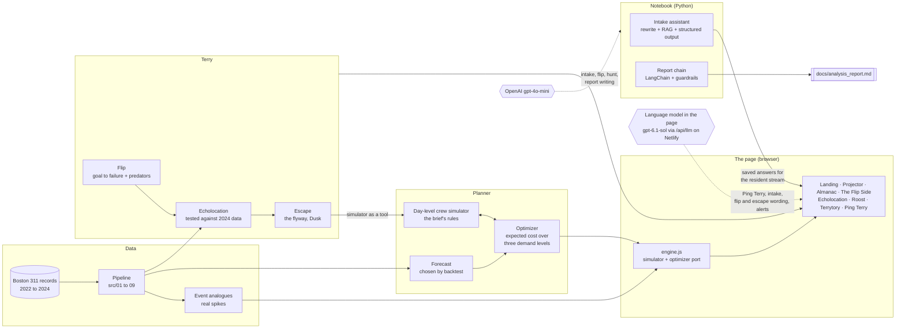

# Bat-Terry: staffing Boston's 311 crews by planning for failure

**IE 5374 Applied Generative AI · Module 7 Hackathon · Topic 2: Staffing Boston's 311 City Service Teams**

Terry is a bat who plans Boston's 311 crews by starting from the failure. A manager names a goal ("every Transportation
request on time in November"). Terry flips it into the year it went wrong, proposes the specific threats that would cause
it (*predators*), tests each one against two years of real 311 records, and finds the cheapest crew plan that escapes
(the *flyway*). The 2025 month-by-month staffing plan, the sensitivity analysis and the written report all come out of
that one mechanism. A 311 intake assistant routes residents' plain-language messages, in English or Spanish, to the
city's real request types.

**Live site:** https://bat-terry.netlify.app ·
**Demo video:** on the site (Who built me, Watch the demo), file `app/zoom/assets/demo/demo.mp4` ·
**Notebook:** `notebooks/Boston311_Terry.ipynb` (every cell run, all outputs visible) ·
**Report:** `docs/analysis_report.md` ·
**How the page behaves, and how we tested it:** `docs/STATES.md`

## Headlines

* **Neutral plan:** $3.16M more crew payroll than keeping January's crews, $9.35M less in overdue and year-end backlog
  costs: an expected 2025 cost of $15.62M, a net $6.19M less, with at least 90% on time from demand 14% under to 14% over
  forecast. Payroll is cash; overdue costs are the brief's price for repeat calls, rework and lost resident trust.
* **The decision that matters most:** Transportation signs 6 new crews by 31 December 2024, so they train in January and
  work from February. That department carries $4.62M of the net savings.
* **Intake assistant:** 82.5% right request type on 200 held-out messages it had never seen; 89.0% after the one fix
  those misses pointed to (a rewrite step for Spanish), scored on the same set, so read 89% as optimistic (98.8% right
  department on routable ones).
* **Inspectional Services:** its lateness is mostly inspection and legal process, not crew count. More crews won't fix it.

## The page

Open it, scroll, name a goal, and press **Chase it**.

* **The landing.** Boston on the last evening of 2024: "2025 starts tomorrow, and its crews are still unplanned." Scrolling
  pulls the camera back from the skyline into the planner, and scrolling up at the top returns to it. On sharp screens
  (Macs, phones, Windows at 150% and up) a lighter version of the move plays, so laptop graphics never drop frames.
* **The projector.** The 2025 plan plays on a projector screen hanging from a branch, at city, department and month level.
  The legends say what every mark counts (crews on plan, crews needed, the likely range of need) and the month view says
  what one crew box is. **Dusk** and **Night** switch the photographs and the palette together.
* **Chase it.** Terry flips the goal, listens for predators (each one confirmed or rejected against 2024 data, live),
  marks Dusk (the last day a new crew can still help) and draws the flyway: who to sign, by when, and what it costs.
* **The Almanac and BUDGETerry.** A split-flap board under the projector reads out each month; the battery beside it
  drains with the year's crew budget.
* **The Flip Side.** The plan section: the goal flipped into the year it failed, the predators with their verdicts, the
  flyway, the verdict and the bill, with the 2025 crew plan as a ledger you can switch between four plans and compare.
* **Echolocation.** The equity map: Boston in hexagons, by who calls 311 less than expected and who waits longer. Hover a
  hexagon for its neighborhood and numbers; zoom and drag to explore.
* **Roost and Terrytory.** The plans Terry found (up to three, compare any two), and the resident side: the intake
  assistant, the resident message stream with its surge warning, and alerts sized by real past spikes.
* **Ping Terry.** The frosted dock at the bottom of the page. Ask about the plan in plain words, report a street problem
  (in English or Spanish), or tell Terry to go somewhere ("open Parks in July", "compare plans"). Terry answers from the
  plan's own numbers, checks every figure it writes, and moves the page to show the answer. While it thinks, the send
  button is a Stop. "Show me around" replays the guided tour.
* **3D Terry** flies in, hangs from the branch, and narrates the first chase.

Without a language model the page still works: Ping answers from rules over the same tools, the intake routes by
retrieval, and every number on screen is computed by the engine either way.

## How the GenAI parts work, and how they are kept honest

| Feature | What the model does | What code does, and the guardrails |
|---|---|---|
| **Intake assistant** (Python §7, page `intake.js`) | Rewrites a resident's message as the problem to fix (translating Spanish), picks one of the retrieved request types, or asks one follow-up question | Retrieval over the city's 124 real routing targets; the model may only choose from those candidates; emergencies get "call 911" before any model; resident text is wrapped as data, never instructions |
| **Ping Terry** (page `ask.js`) | Chooses tools, answers in Terry's voice, chooses page actions | Ten tools over the plan; at most 4 tool calls, a hard stop at 6, a 45 s cap; every number must appear in a tool result, a cited glossary chunk or the page state, or it is rewritten once and then removed; actions are cleaned to an allowed set; any failure falls back to the rules answer, labelled |
| **The flip and the hunt** (Python §6, page `flyover.js`) | Turns a goal into its failure and proposes predators | Predators must be real request types and neighborhoods, then each is tested against 2024 records; event sizes come from real spikes, never from the model |
| **The report** (Python §9) | Writes the interpretive paragraphs | LangChain chain with a number guardrail and a critic pass |

Evaluated in the notebook: the flip (§6.4: 24 flips, 0 invented request types, 0% unsourced numbers on the first try,
56% of testable predators confirmed by 2024 data), Ping (§6.6: 42 questions, 100% routing, retrieval and guardrail pass
on the rules path; live, 42 of 42 answers passed the number check at about $0.001 a question) and the intake (§7).

`docs/STATES.md` maps the page's state machines (the landing camera, Terry's flight, the chase, the guide and Ping's
chat) and the path a question takes through the model, with the rules that must always hold and the bugs a
fault-injection test and a random-order stress test found and fixed.

## Architecture



## What's in the repo

| Path | What it is |
|---|---|
| `notebooks/Boston311_Terry.ipynb` | The submission notebook, built by `notebooks/build_notebook.py` |
| `notebooks/*_audit.cjs`, `*_mock_test.cjs`, `ping_eval.cjs` | The page's GenAI code checked in Node: Ping, intake, map and session, with a scripted model |
| `app/zoom/` | The page: landing, projector, Almanac, The Flip Side, Echolocation, Roost, Terrytory, Ping Terry |
| `app/zoom/tests/` | Browser tests: laptop sizes, round trips, AI fault injection, the random-order stress test, the repaint profiler (see its README) |
| `app/live/` | The browser engine (`engine.js`, within 0.5% of the Python, `validate.mjs`), Terry's model layer (`terry.js`), goals, escape and alerts (`flyover.js`), `data.json` |
| `app/bat3d/`, `app/brand/` | The 3D Terry and the bat artwork |
| `deploy/` | The Netlify build: `build.py`, `host.js` (the page's model through `/api/llm`), the function `netlify/functions/llm.mjs` with daily limits |
| `src/` | Data pipeline, forecast backtest, simulator, optimizer, full plan, ISD analysis, map data, event analogues |
| `terry/` | The Python GenAI layer: flip, echolocation, hunt (agent), decision calendar, report chain, intake assistant |
| `data/tests/` | Intake test sets: seed (50), held-out v1 (200), held-out v2 (120) |
| `docs/` | The analysis report, `STATES.md`, the architecture diagram, the demo script |

## How to run

**The notebook** (no raw data needed; the processed data is committed):

```bash
python3 -m pip install -r requirements.txt
mkdir -p config && printf "OPENAI_API_KEY=...\n" > config/llm.local   # gitignored, optional
python3 notebooks/build_notebook.py
cd notebooks && python3 -m nbconvert --to notebook --execute --inplace Boston311_Terry.ipynb
```

Without a key, every model cell shows its last saved run. §6.5 and §6.6 need Node 18 or newer. A full live run takes a
few minutes and a few hundred `gpt-4o-mini` calls (under $1).

**The page, locally.** `python3 deploy/build.py` writes the whole site to `deploy/site/`; serve it with
`python3 -m http.server -d deploy/site 8000` and open http://localhost:8000 (without the Netlify function, Ping answers
from its rules). The browser tests use `app/zoom/bshoot.cjs`, which serves `app/zoom/` with the shared files mapped in.

**The hosted site.** `deploy/README.md`: one Netlify site, the OpenAI key as an environment variable (never in the
page), and two daily limits (site spend and calls per visitor). Over a limit, the page answers from its rules.

**Checks.**

```bash
node app/live/validate.mjs                 # browser engine against the Python
for t in ping_mock_test ping_session_mock_test ping_map_mock_test intake_mock_test ping_eval card_audit flip_audit event_audit; do node notebooks/$t.cjs; done
node app/zoom/tests/ai-faults.cjs          # Ping on the hosted build against a failing, slow or looping model
node app/zoom/tests/stress.cjs 7 200       # 200 random actions, the page's rules checked after each
node app/zoom/guide-shoot.cjs day          # the guided tour and chase end to end
```

**Rebuild from raw data** (about 45 minutes, mostly the optimizer). Download "311 Service Requests" 2022, 2023 and 2024
from https://data.boston.gov/dataset/311-service-requests into `data/raw/` as `311_2022.csv`, `311_2023.csv`, `311_2024.csv`, then:

```bash
python3 -I src/01_load.py data/raw data/processed
python3 -I src/02_aggregate.py data/processed
python3 -I src/04_forecast_backtest.py data/raw data/processed
python3 -I src/05_silence.py data/processed
python3 -I src/06_full_plan.py
python3 -I src/07_isd_process.py data/processed
python3 -I src/08_map_data.py data/processed
python3 -I src/09_event_analogues.py data/raw data/processed
python3 -m terry.describe_types     # model, once: type descriptions for retrieval
python3 -m terry.showcase           # model: one saved Terry run per department
python3 -I app/build_live_data.py   # writes app/live/data.json
node app/live/validate.mjs
```

Try Terry from the command line: `python3 -m terry.run "I close every Public Works request on time in 2025." neutral`

## Key modeling decisions

1. **Forecast chosen by backtest.** Four methods forecast 2024 from 2022-23; a seasonal two-year average re-leveled to the
   latest year had the lowest error.
2. **Plan for the forecast's known error.** Plans minimize expected cost over whole-year demand ×0.86, ×1.00 and ×1.14
   (weights 1/6, 2/3, 1/6). A point-forecast plan broke at +5% demand.
3. **Modes are service floors:** passive (none), neutral (at least 90% on time across the planning range), aggressive
   (at least 95%, and 90% even at +20%).
4. **Year-end backlog is a cost**, so long-target departments can't look good by pushing work into 2026.
5. **Shocks come from the data:** the January 2022 blizzard, the 1 September 2023 move-in weekend and other real spikes
   size the events.

Full assumptions and limitations are in §10 of the notebook.

## AI use

* **Language model in the page.** The page uses OpenAI `gpt-6.1-sol` (low reasoning effort) through the site's own Netlify
  function, which holds the key. The notebook's live Ping evaluation (§6.6) was run on `gpt-4o-mini`, before the site moved
  to `gpt-6.1-sol`. The model reads goals, alerts and
  questions, writes the flip and escape wording, names predators for the data to test, routes resident reports and
  answers Ping Terry with tools over the plan. It never supplies a number: the engine computes every figure and a
  guardrail checks the ones the model writes.
* **OpenAI in the notebook.** `gpt-4o-mini` runs the intake assistant, the flip and hunt in §6 and the report's
  interpretive paragraphs (§9, checked by a number guardrail and a critic chain). `gpt-4o` generated the held-out test
  messages. Cells whose output comes from a model at run time are marked **[LLM output]**.
* **Images.** The hero photos (Boston at dusk and at night), the projector photos and the hilltop footer photos are
  AI-generated images we made with ChatGPT.
* **Coding assistant.** We used an AI coding assistant throughout. It helped write much of the code (the data pipeline,
  simulator, optimizer, the GenAI layer and the web page) and drafted much of the notebook's explanatory text. We set the
  direction, made the modeling decisions, and reviewed and checked everything.
* **Demo video.** The same coding assistant helped edit the demo video and code its animations. The narration is our own
  voice. The background music was generated with Sonilo.

We reviewed and are responsible for everything submitted, per Northeastern's Academic Integrity and Use of AI policy.

## Contributions

**Team:** Santhoshkumar Chandrasekar (Wing Lead), Harrish Ebi Francis P (Sonar Bridge), Pradyuman Turlapati (Night Watch).

| Work package | What it covers | Owner |
|---|---|---|
| Concept and product direction | Goal inversion ("Terry"), predators, modes, the page | Santhoshkumar Chandrasekar |
| Data pipeline and forecast | `src/01` to `05`, the backtest, the silence signal | Santhoshkumar Chandrasekar |
| Simulator and optimizer | `src/sim.py`, `src/optimize.py`, `src/06_full_plan.py`, sensitivity | Santhoshkumar Chandrasekar |
| Terry GenAI layer | `terry/`, `app/live/terry.js`, `flyover.js`, guardrails, the flip evaluation | Santhoshkumar Chandrasekar |
| Intake assistant and test sets | `terry/intake.py`, test generation, labeling, evaluation | Santhoshkumar Chandrasekar |
| Page, notebook, report, video | `app/zoom/`, `notebooks/`, `docs/analysis_report.md`, the demo video | Santhoshkumar Chandrasekar |

**Verification**

| Check | What it covers | Owner |
|---|---|---|
| Reproducibility | A clean run of the notebook on a second machine, the headline numbers checked: `docs/reproduce.md` | Harrish Ebi Francis P |
| QA and deployment | The test suites and the live site on other devices and browsers: `docs/qa_report.md` | Pradyuman Turlapati |

## Data

City of Boston, 311 Service Requests (Analyze Boston), Open Data Commons Public Domain Dedication and License. Crew
capacities, costs, starting levels and overdue costs are the hackathon brief's planning assumptions.
