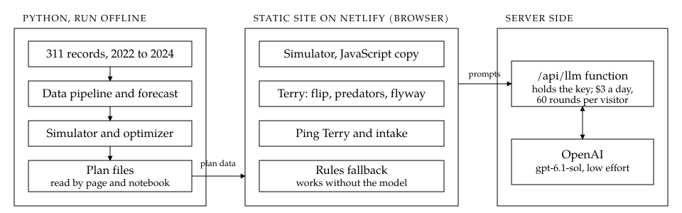

# Bat-Terry: a 2025 crew plan for Boston 311

**Project report** · IE 5374 Applied Generative AI, Module 7 Hackathon · Northeastern University · November 2026

Santhoshkumar Chandrasekar (Wing Lead) · Harrish Ebi Francis P (Sonar Bridge) · Pradyuman Turlapati (Night Watch)

Live site: https://bat-terry.netlify.app · Demo video: https://youtu.be/U-ltQXELWZ0 ·
Code: https://github.com/santhoshkchandrasekar/Bat-Terry

---

## Summary

Boston's 311 system received 306,756 requests in 2024. Four departments in scope do the field work, and their
performance differs sharply: Parks closed 93% of requests on time, Public Works 90%, Inspectional Services 72% and
Transportation only 50%. We built a month-by-month crew plan for 2025 and a GenAI application, Bat-Terry, that puts the
plan in a manager's hands.

The recommended plan grows the four departments from 94 crews in January to 127 by August. It spends $3.16M more on
crew payroll than keeping January's crews and avoids $9.35M in overdue and year-end backlog costs: an expected 2025 cost
of $15.62M against $21.81M, a net $6.19M less. The single most important decision is in Transportation: sign 6 new
crews by 31 December 2024, so they train in January and work from February. That decision carries $4.62M of the
savings.

Bat-Terry plans from failure. A manager names a goal; Terry, the bat, imagines the year it went wrong, proposes specific
threats (*predators*), tests each one against 2024 records, and prices the cheapest crew plan that avoids them (the
*flyway*). A 311 intake assistant routes residents' plain-language messages, in English or Spanish, to the city's real
request types. The language model never supplies a number: a forecast, a simulator and an optimizer compute every
figure, and a guardrail checks every number the model writes.

| Key result | Value |
|---|---|
| Expected 2025 cost, recommended plan | $15.62M (vs $21.81M keeping January's crews) |
| On time, recommended plan (crew model) | 98.0% across the city; Transportation 98.7% (50% in 2024) |
| Intake assistant, 200 unseen messages | 82.5% right request type (89.0% after one fix, measured on the same set) |
| Terry's predators confirmed by 2024 data | 56% of testable ones, with no invented request types |
| Live Ping answers passing the number check | 42 of 42 |

## 1. The problem

The brief asks how many crews Public Works, Transportation, Parks and Inspectional Services need in each month of 2025,
balancing cost, on-time service and flexibility under the hiring and release rules: a new crew needs one month of
hiring and training; a release needs one month of notice and costs 25% of a crew's annual cost; Parks may add seasonal
crews from April to October at 1.3 times the cost. Each overdue request costs $20, and $100 more once it is 30 days past
due. Crew capacities, costs and starting levels are the brief's planning assumptions; the request data is real.

## 2. Data

We used the City of Boston's public 311 records for 2022, 2023 and 2024, cut to the four departments and aggregated to
monthly counts early. The extra year lets us test the forecast on a year we already know (Section 3).

One trap mattered: the raw timestamps mix two formats, and default parsing silently lost 29% to 44% of the dates in two
departments. We parse every timestamp explicitly and check that none fail. About 16% of 2024 requests have no target date;
they use crew capacity but never count as late.

## 3. Forecast

We forecast every month of 2024 from 2022 and 2023 with four methods and compared the results with what actually
happened. A seasonal average of the last two years, re-leveled to the latest year, had the lowest error on average and
in three of four departments, and we use it for 2025.

| Monthly error (MAPE), forecasting 2024 | Seasonal average | Seasonal naive | Damped growth | Holt-Winters |
|---|---|---|---|---|
| Public Works | **10.8%** | 13.6% | 23.2% | 28.2% |
| Transportation | 7.3% | 7.6% | 7.6% | **5.4%** |
| Parks | **14.0%** | 17.7% | 17.2% | 14.4% |
| Inspectional Services | **7.8%** | 13.3% | 13.6% | 8.5% |

The backtest's most useful finding is the *shape* of the error. The annual error is about as large as the monthly error
(Transportation 7.5% against 7.3%; Public Works 8.7% against 10.8%), so the risk is mostly a whole-year level shift, not
month-to-month noise. No forecaster removes a shift it can't see coming, so the plan is built to absorb it.

## 4. The 2025 staffing plan

**Simulator.** A day-by-day simulator replays 2024's real requests into 2025, each with its real target date, scaled to
the forecast. Crews close the earliest-due requests first, five days a week, up to capacity. It applies every rule in
the brief and charges for requests still open on 31 December, so long-target departments can't look good by pushing
work into 2026. A full year runs in about 15 milliseconds.

**Planning for forecast error.** Our first plan, optimized on the forecast alone, broke at +5% demand: Transportation's
on-time rate fell from 99% to 17% at +10%. The final plans minimize expected cost over three whole-year demand levels
(14% under, on, and 14% over forecast, weighted 1/6, 2/3, 1/6), a spread calibrated from the backtest error. Three
modes add a service floor: **passive** (none), **neutral** (at least 90% on time at every level) and **aggressive** (at
least 95%, and 90% even at +20% demand).

| Plan | Expected 2025 cost |
|---|---|
| Do nothing (January's crews all year) | $21.81M |
| Passive | $15.21M |
| **Neutral (recommended)** | **$15.62M** |
| Aggressive | $16.25M |

The neutral plan costs $410k more than the cheapest, and that difference buys at least 90% on time at every planning
level. Its crews by month:

| Crews, neutral plan | Jan | Feb | Mar | Apr | May | Jun | Jul | Aug | Sep | Oct | Nov | Dec |
|---|---|---|---|---|---|---|---|---|---|---|---|---|
| Public Works | 50 | 50 | 56 | 60 | 60 | 62 | 66 | 70 | 70 | 70 | 70 | 70 |
| Transportation | 18 | 24 | 24 | 24 | 26 | 26 | 26 | 26 | 26 | 26 | 26 | 26 |
| Parks | 10 | 10 | 10 | 10 | 10 | 12 | 12 | 12 | 12 | 12 | 12 | 12 |
| Inspectional Services | 16 | 16 | 16 | 16 | 18 | 18 | 19 | 19 | 19 | 19 | 19 | 19 |
| **City** | **94** | **100** | **106** | **110** | **114** | **118** | **123** | **127** | **127** | **127** | **127** | **127** |

Every change is a dated decision: a crew who works from month M must be signed by the last day of month M-2.

| Department | Cost, neutral plan | Cost, January's crews | On time, plan | On time, January's crews |
|---|---|---|---|---|
| Public Works | $8.46M | $9.68M | 97% | 56% |
| Transportation | $2.83M | $7.44M | 99% | 20% |
| Parks | $1.60M | $1.78M | about 100% | about 100% |
| Inspectional Services | $2.73M | $2.91M | 99.9% | 98% |

Three decisions follow from the rules rather than the forecast:

- **No releases after the peak.** A release costs three months of pay plus a month of notice, and after the summer peak
  there are never more than three idle months left. Releasing 2 Parks crews from September costs $153,147 more than
  keeping them.
- **No seasonal Parks crews**, though the brief offers them. 57% of Parks requests have a 365-day target, so regular
  crews can work off the summer peak over the winter at the base cost. The search tried seasonal options explicitly, and
  none won.
- **More crews won't fix Inspectional Services.** The model says ISD has the capacity to close nearly everything on time,
  yet 28% of its 2024 requests were late. Its lateness sits in request reasons with short targets and long real close
  times (inspection scheduling, legal steps). That calls for a process review, not hiring.

## 5. Sensitivity and risk

| On time, neutral plan | Demand −20% | −14% | Forecast | +14% | +20% | Snowstorm | Heat wave |
|---|---|---|---|---|---|---|---|
| Public Works | 100% | 99% | 98% | 90% | 58% | 98% | |
| Transportation | 100% | 100% | 100% | 92% | 17% | | |
| Parks | 100% | 100% | 100% | 100% | 100% | | 100% |
| Inspectional Services | 100% | 100% | 100% | 100% | 100% | | 100% |

The snowstorm and heat wave are sized from real spikes in the data, such as the January 2022 blizzard. The plan holds
through both shocks and across its planning range. At +20% it breaks in Public Works (58%) and Transportation (17%),
and the year's cost rises to $20.43M. The aggressive plan is the insurance: 90% or better everywhere even at +20%, for
$0.68M more payroll and $0.63M more expected cost, and it becomes the cheaper plan if demand really does run 20% high
($18.16M against $20.43M). Choosing between them is a policy call.

Each department's on-time rate stays above 90% until demand runs over forecast by 16% (Public Works, Transportation), 26%
(Inspectional Services) or 56% (Parks). Monitoring recovers much of the rest: if the first half of 2025 runs 20% hot,
re-planning on 1 July lifts Public Works' on-time rate for the year from 58% to 90%, and Transportation's from 17% to 56%.

## 6. The GenAI layer

Bat-Terry combines prompt engineering, structured output, retrieval (RAG), an agent with tool calling and LangChain.

- **The flip and the hunt.** The model turns a goal into its failure and proposes predators, choosing only from the
  city's real request types and neighborhoods (enforced by the output schema). Code then tests each predator against
  2024 records, and an agent with tool calls over the simulator prices the flyway. The model proposes; the data decides.
- **The intake assistant.** A resident's message is rewritten into a short English problem statement, which rescues
  Spanish and rambling messages. Both versions are matched against 124 real request types (those used at least 25 times
  in 2023 and 2024, covering 99.9% of requests) with embeddings and keyword search. The model then picks one candidate as
  structured output (type, department, queue, confidence) or asks one follow-up question.
- **Ping Terry.** The chat dock on the page, and the main way to talk to the plan. Questions go to an agent with 13
  tools over the plan: the city and department views, a month day by day, why a month's demand looks as it does, the
  forecast's accuracy, each hiring decision with and without it, what-if crew changes, the budget, neighborhood equity,
  street reports matched to request types, a search over a 28-chunk knowledge base (glossary, report, method) whose
  sources it cites, and the state of the page itself, so it can explain whatever is on screen. After answering it acts on
  the page to show the answer: it zooms the projector, highlights the bar or line in question, opens a month's demand
  explanation, plays the street scene or opens the equity map. Calls are limited to 4, with a hard stop at 6 and a
  45-second cap, and the last three exchanges give follow-ups their context. Page commands (switch the theme or plan,
  compare plans, zoom, play a month, jump to a day) and trips to ten named places on the page are matched by rules
  before the model, so they are instant and never invent a place.
- **Reading free text.** The model reads a typed goal into a department, months and target, and a pasted alert into an
  event kind and dates. Code then sizes the event from the closest real spike in 2022 to 2024 (for example the January
  2022 blizzard) and runs the plan with and without it. Rules do the same reading when the model is unavailable.
- **Safety.** Whatever a person types or pastes is treated as data: instruction-like phrases are cut, delimiters can't be
  closed from inside, lengths are capped, and off-topic questions get a short redirect. The guided tour and Terry's
  narration of the first chase are fixed text, not model output.
- **The report.** A LangChain chain writes the interpretive paragraphs from facts that carry their own scope. A number
  check and a second critic chain review each paragraph. After testing showed the model would sometimes attach a correct
  figure to the wrong period, we moved the placement of figures into code.

The guardrail common to all of them: every number the model writes must appear in a tool result or the facts it was
given, or it is rewritten once and then removed. Every feature also has a rules fallback, so the page works without the
model.

## 7. Evaluation

| What we tested | How | Result |
|---|---|---|
| Intake assistant | 200 messages generated by a different model (gpt-4o), never seen in tuning, frozen before scoring | 82.5% right request type. After one fix those misses pointed to: 89.0% type, 98.8% department (optimistic, as it was measured after looking) |
| Intake, unclear messages | Messages that need a follow-up question | Asked one, or chose an accepted type, on 83% |
| The flip | 24 flips: 8 goals, 3 repeats each | 156 predators; 56% of testable ones confirmed by 2024 data; 0 invented types; 0% unsourced numbers on the first try |
| Ping, rules path | 42 questions, written alongside the router (a regression check, not unseen questions) | 100% routing, retrieval, guardrail and navigation |
| Ping, live model | The same 42 questions, on `gpt-4o-mini` | 42 of 42 passed the number check; about $0.001 a question |
| Flip and predator cards | Every card the page can show: 240 goals for the flip, 340 for the predators; then a model read each distinct flip wording as a city manager would | 0 cards break the rules (the first run broke 128 of 240, and the templates were rewritten) |
| Browser engine | The page's simulator against the Python one | Within 0.5% |

We report these numbers as they are. A no-model baseline that lists each department's costliest 2024 cells is confirmed
more often than Terry's predators (85%), because those cells are late by definition; the flip's value is the threats a
cost ranking would never list, and about half of those are confirmed. Of 33 confirmed crew predators, 28 stayed under
90% on time even in their department's best months, so much of the lateness Terry hears is in how work is handled, not
crew numbers. The written report's critic also flagged one claim it could not verify, a Roxbury cost figure in the
Inspectional Services section; we left the flag visible in the report rather than remove it.

## 8. Other considerations: who isn't calling, and who waits

City workers, not residents, logged 53% of 2024 requests in the four departments. Worker-logged requests close faster;
residents wait longer in three of four departments. We measured two separate kinds of under-service across 19
neighborhoods:

- **Silence:** residents reporting less than the city norm for the same kinds of problems. South Boston / Waterfront
  (0.76 of the norm) and Mission Hill (0.78) are the quietest. The measure is stable from year to year (rank
  correlation 0.88).
- **Waiting:** requests running later than the neighborhood's own mix of request types predicts. Charlestown, Hyde Park,
  Greater Mattapan, West Roxbury and East Boston are both quiet and slow.

We found no vicious loop over one year: neighborhoods that waited longer in 2023 did not call less in 2024 (largest
correlation 0.17, none significant). The quiet places are not the slow ones, so they need two different fixes: outreach
where it is quiet, and a look at the queue where it runs late.

## 9. Architecture

The planning model is Python: the data pipeline, the forecast, the simulator and the optimizer write the plan files the
page reads. The page is a static site on Netlify with its own JavaScript copy of the simulator, so every number on screen
is computed in the browser. One serverless function holds the OpenAI key and caps live AI use at $3 of model spend per
day for the whole site and 60 model rounds per visitor; over a limit, the page answers from its rules. The page uses
`gpt-6.1-sol` at low reasoning effort; the notebook's evaluations use `gpt-4o-mini`, and `gpt-4o` generated the held-out
test messages.

## 10. Limitations

- On-time rates are outputs of the crew model under the brief's assumed capacities, not predictions of real-world rates.
  The model is harsher than 2024's record for Public Works and Transportation at January crew levels (56% on time for
  Public Works against a real 90%), so its crew numbers there are an upper bound. Comparisons between plans are the point.
- Parking enforcement fits a crew model poorly: most of those requests resolve when the car leaves.
- The held-out intake messages are model-generated; we reviewed their labels, but 311 staff did not.
- The silence measure compares like-for-like request types; it is not population-normalized.
- The crew model counts only lateness caused by too few crews. Process delays, which dominate Inspectional Services,
  are reported separately.

## 11. Team and AI use

| Member | Role | Contribution |
|---|---|---|
| Santhoshkumar Chandrasekar | Wing Lead | Concept and product direction; data pipeline and forecast; simulator and optimizer; the GenAI layer; intake assistant and test sets; the web page; the notebook, reports and demo video |
| Harrish Ebi Francis P | Sonar Bridge | Reproducibility check: a clean run of the notebook on a second machine (`docs/reproduce.md`) |
| Pradyuman Turlapati | Night Watch | QA and deployment check: the test suites and the live site on other devices (`docs/qa_report.md`) |

**AI use.** We used an AI coding assistant throughout. It helped write much of the code and drafted much of the
notebook's explanatory text; we set the direction, made the modeling decisions, and reviewed and checked everything.
OpenAI models produce the notebook cells marked [LLM output]. The site's photographs are AI-generated images made with
ChatGPT. The demo video was edited with the coding assistant, with our own narration and background music generated with
Sonilo.

## Where to find more

| Document | What it holds |
|---|---|
| `notebooks/Boston311_Terry.ipynb` | The full analysis, every cell run |
| `docs/analysis_report.md` | The staffing analysis by department, generated by the notebook |
| `docs/DECISIONS.md` | Every design decision, with the alternatives we rejected and why |
| `docs/USER_GUIDE.md` | How to use the site |
| `README.md` | Setup, repository layout and how to run everything |
